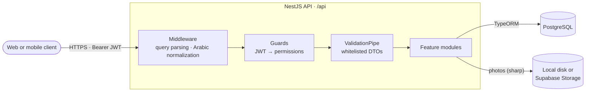
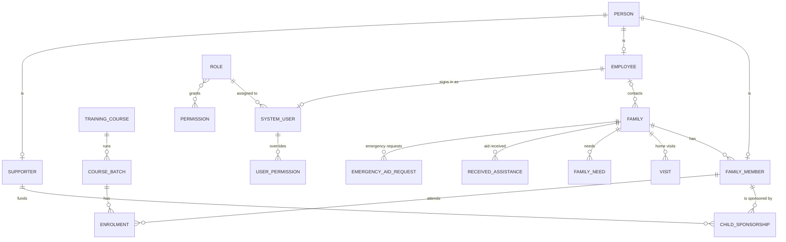

<div align="center">

# Al-Barakah Backend

**REST API for the case-management system of Al-Barakah Charity Association.** Staff use it to register families in need, record intake interviews and home visits, track each family's needs and the aid it receives, manage supporters and the children they sponsor, and run training courses. Access is controlled by fine-grained permissions, and every message is available in Arabic and English.

[](https://nestjs.com)
[](https://www.typescriptlang.org)
[](https://www.postgresql.org)
[](https://typeorm.io)
[](https://nodejs.org)
[](#localization)

</div>

## Highlights

- **The whole case lifecycle.** An intake interview opens a family file and registers its guardian in one transaction. Staff then add family members, record home visits, log needs by priority, and track the aid each family receives and its emergency requests.
- **Sponsorships.** Each supporter has a sponsorship type (comprehensive or orphan fund), an amount and a payment cycle (monthly to annual). A child sponsorship links a supporter to a child, with start and end dates and a status: active, paused, ended or cancelled.
- **Training programmes.** Courses run in batches. Family members enrol in a batch, and each enrolment records the member's attendance.
- **Fine-grained access control.** 70 permissions cover the actions on each resource. Every user has a role, and single permissions can be granted to or denied for one user on top of that role. The `Superadmin` role can't be edited or deleted, and its users' permissions can't be overridden.
- **One active session per user.** Access tokens are JWTs. Signing in again or changing the password invalidates every token issued before it.
- **Arabic-aware input.** Arabic text in every request body, route parameter and query string is normalized before it reaches the services: hamza forms, taa marbuta, alef maqsura, diacritics, tatweel and Eastern Arabic digits. A record saved through the API is found whichever spelling variant is searched, for example أحمد or احمد.
- **Monthly statistics.** Families, family members, visits, supporters and course batches each have a `monthly-stats` endpoint. It returns a count for every month in a date range, including months with no records.
- **Filtering and pagination.** List endpoints accept nested filters in dot notation (`person.fullName=…`) and ranges (`visitDateFrom=…&visitDateTo=…`), and return the same pagination block.
- **Checked file uploads.** Person photos are checked by file signature (magic bytes) and size, then compressed with sharp before they are stored. Storage is pluggable: local disk (the default) or Supabase Storage.
- **Validated configuration.** Zod validates every environment variable at startup. The app won't boot with a missing value or a weak super-admin password.

## Architecture



One interceptor wraps every response in the same envelope. Errors go through a global exception filter that picks a handler by error type: HTTP, JWT, Multer or TypeORM. For example, a PostgreSQL unique-key violation becomes a `409` with the message "This record already exists".

### Domain model



## API

All routes are under `/api`. Apart from login, every module route needs an `Authorization: Bearer <token>` header and the permission for that action.

| Area | Routes | What it covers |
| --- | --- | --- |
| Auth | `POST /auth/login` | Username and password in, access token and user profile out |
| Staff accounts | `/system-users`, `GET /system-users/me` | Accounts linked to employees, each with a role |
| Access control | `/roles`, `/permissions`, `/user-permissions` | Roles and their permissions, a user's effective permissions, and per-user grants and denials (one at a time or in bulk) |
| Employees | `/employees` | Staff records |
| People | `/persons` | Personal data shared by family members, employees and supporters |
| Intake interviews | `/interview` | Opens a family file together with its guardian, and lists families with their guardian and members |
| Families | `/families` | The case file, opened by an intake interview: request status, management decision, housing, sponsorship status and archive location |
| Family members | `/family-members` | Relation to the guardian, whether the member is present, education, and sponsorship |
| Home visits | `/visits` | The visit committee's assessment: housing, furnishings and appliances, income and spending, and its evaluation |
| Needs | `/family-needs` | Needs with a priority (critical to minimal) and a status (pending, partially met, fulfilled, self-resolved) |
| Aid received | `/received-assistance` | Cash, food, clothes, medicine, shelter, education, hygiene and transport |
| Emergency aid | `/emergency-aid-requests` | Requests that move from pending to approved and disbursed, or end as rejected or cancelled |
| Supporters | `/supporters`, `/supporter-child-sponsorships` | Supporters and the children they sponsor |
| Training | `/training-courses`, `/course-batches`, `/person-course-batches` | Courses, their batches, and member enrolments |
| Lookups | `/dropdowns` | Option lists, managed by admins, for the client's select fields |
| Files | `/uploads` | Upload or delete a person's photo |

A ready-made Postman collection is in [`Al Barakah Charity Association.postman_collection.json`](Al%20Barakah%20Charity%20Association.postman_collection.json). It has 102 requests grouped by module. Create an environment with `url` set to `http://localhost:3000/api`. The **Login** request saves the token to `accessToken`, and every other request uses it.

### Responses

Successful responses share one envelope. List endpoints add a `pagination` block and accept `page` and `limit` (default 10):

```json
{
  "data": [{ "id": 1, "formNumber": "…" }],
  "pagination": {
    "limit": 10, "currentPage": 1, "total": 6, "totalPages": 1,
    "nextPage": null, "prevPage": null, "hasNextPage": false, "hasPrevPage": false
  },
  "meta": {
    "message": "Data retrieved successfully", "statusCode": 200, "status": "success",
    "timestamp": "2026-10-13T13:06:56.025Z", "path": "/api/families", "method": "GET",
    "requestId": "req_…"
  }
}
```

Errors return `status`, `statusCode`, a translated `message` and a `traceId`.

### Localization

Messages and validation errors are available in English and Arabic. The language comes from the `?lang=ar` query parameter, the `Accept-Language` header or the `x-lang` header, in that order. English is the fallback.

## Tech stack

**NestJS 11** · TypeScript · **PostgreSQL** · **TypeORM 0.3** · class-validator and class-transformer · Zod · nestjs-i18n · JSON Web Tokens and bcrypt · Helmet · compression · Multer, sharp and magic-bytes.js · Supabase Storage (optional) · @nestjs/schedule

## Project structure

```
src/
├── main.ts                    # Helmet, compression, CORS, validation, /api prefix, static /uploads
├── app.module.ts
├── common/                    # Guards, decorators, custom validators, interceptors, middleware, pagination
├── modules/
│   ├── auth/                  # Login
│   ├── system-users/          # Staff accounts
│   ├── roles/                 # Roles, permissions and per-user overrides
│   ├── employees/
│   ├── persons/               # Personal data shared by members, employees and supporters
│   ├── interview/             # Intake: family and guardian in one transaction
│   ├── families/
│   ├── family-members/
│   ├── family-needs/
│   ├── visits/
│   ├── received-assistance/
│   ├── emergency-aid-request/
│   ├── supporters/            # Supporters and child sponsorships
│   ├── training-courses/      # Courses, batches and enrolments
│   ├── dropdowns/
│   ├── uploads/
│   └── backup/                # pg_dump and an uploads archive, plus restore
├── shared/
│   ├── exceptions-filter/     # Global filter with one handler per error type
│   └── modules/               # Config (Zod), i18n (ar/en), JWT, storage, TypeORM
└── scripts/
    ├── seeds/                 # Demo-data seeders
    └── i18n-scripts.ts        # Translation check and key generation
env/                           # .env (shared) and one file per environment
scripts/                       # Developer tools: module generator, import-path converter
```

## Getting started

**Requirements:** Node.js 20 or newer, and PostgreSQL. On first start, the app creates the database if it doesn't exist. The configured user needs permission to create databases, or you can create the database yourself.

```bash
git clone https://github.com/aymansalkhatib/albarakah-backend.git
cd albarakah-backend
npm ci
```

### Configure

Settings come from `env/.env`, plus the file for the current `NODE_ENV`: `env/.env.development`, `env/.env.production` or `env/.env.test`. The committed values are placeholders. Set at least the database connection, the JWT secret and the super-admin password before the first run.

| Variable | Purpose |
| --- | --- |
| `PORT` | HTTP port (3000) |
| `POSTGRES_HOST`, `POSTGRES_PORT`, `POSTGRES_USER`, `POSTGRES_PASSWORD`, `POSTGRES_DATABASE` | Database connection |
| `JWT_ACCESS_SECRET` | Secret that signs access tokens |
| `JWT_ACCESS_EXPIRES_IN_MS` | Token lifetime in milliseconds (`900000` = 15 minutes) |
| `SUPER_ADMIN_PASSWORD` | Password of the seeded `superadmin` account: at least 8 characters, with upper- and lower-case letters, a digit and one of `@$!%*?&` |
| `BASE_PATH` | Folder for uploaded files (`./uploads`) |
| `SUPABASE_URL`, `SUPABASE_BUCKET`, `SUPABASE_SERVICE_ROLE_KEY` | Used only by the Supabase storage provider. The placeholders are fine for local storage. |
| `APP_NAME`, `LOG_REQUEST`, `LOG_ERROR` | Shared settings in `env/.env` |

### Run

```bash
npm run seed:dev -- all    # roles and permissions, the superadmin account, and demo data
npm run start:dev          # http://localhost:3000/api
```

The schema is created and kept in sync from the entities when the app starts (TypeORM `synchronize`). There are no migration files.

Sign in with the seeded account, then send the returned `accessToken` as a Bearer token:

```bash
curl -X POST http://localhost:3000/api/auth/login \
  -H "Content-Type: application/json" \
  -d '{"username": "superadmin", "password": "<SUPER_ADMIN_PASSWORD>"}'
```

### Scripts

| Command | What it does |
| --- | --- |
| `npm run start:dev` | Starts in watch mode with `NODE_ENV=development` |
| `npm run build`, then `npm run start:prod` | Compiles to `dist/` and runs with `NODE_ENV=production`. In production, the database connection uses SSL. |
| `npm run seed:dev -- <names>` | Builds, then runs the chosen seeders: `all`, or a list such as `permission system-users families` |
| `npm run seed:prod -- <names>` | The same, with the production settings |
| `npm run i18n:check` | Checks that the Arabic and English translations have the same keys, and regenerates the typed key list |
| `npm run lint`, `npm run format` | ESLint (with `--fix`) and Prettier |

The seeder names are `permission`, `system-users`, `employees`, `families`, `family-members`, `family-needs`, `emergency-aid-requests`, `received-assistance`, `training-courses`, `course-batches`, `person-course-batches`, `supporters`, `visits` and `all`.
